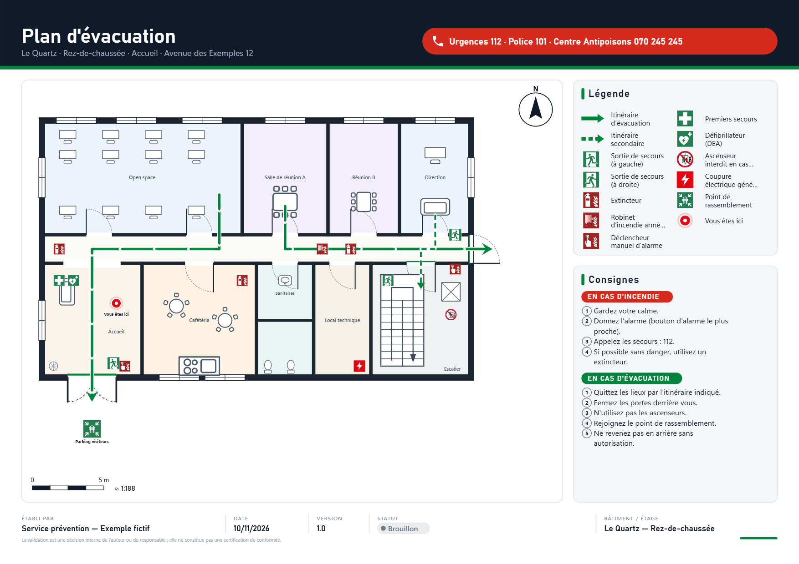
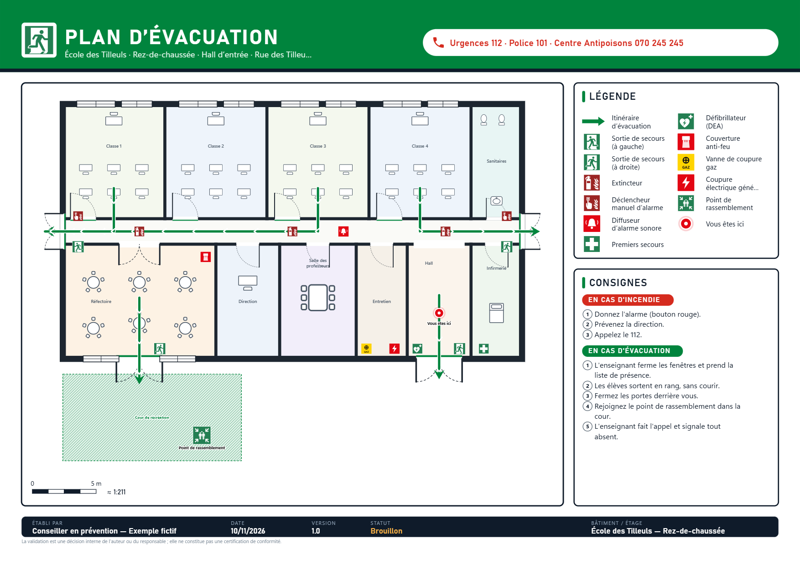
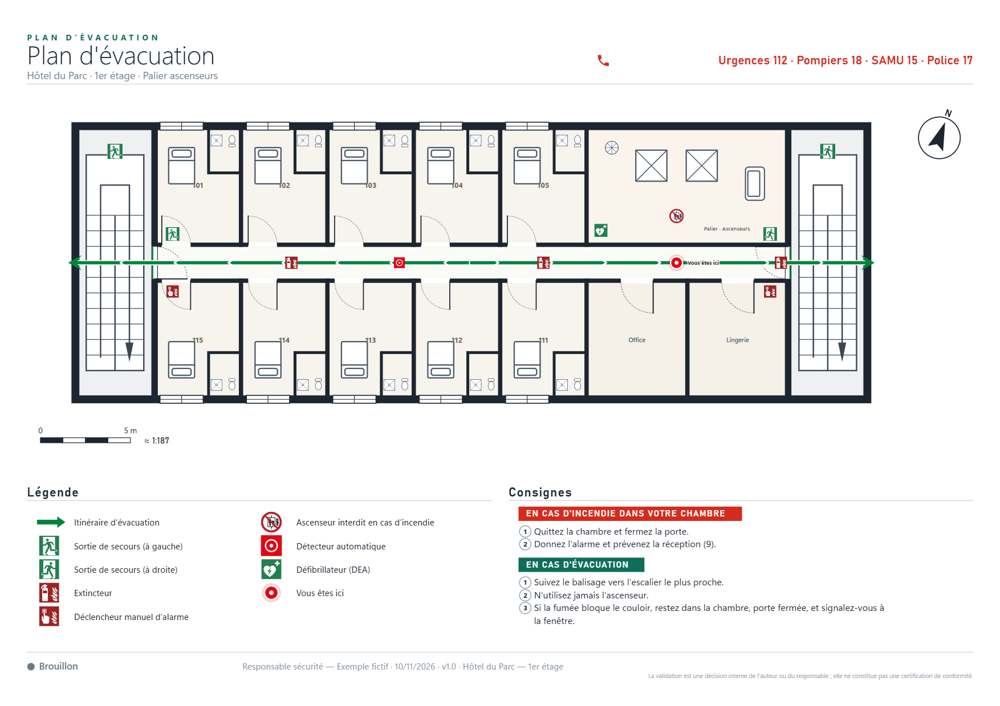
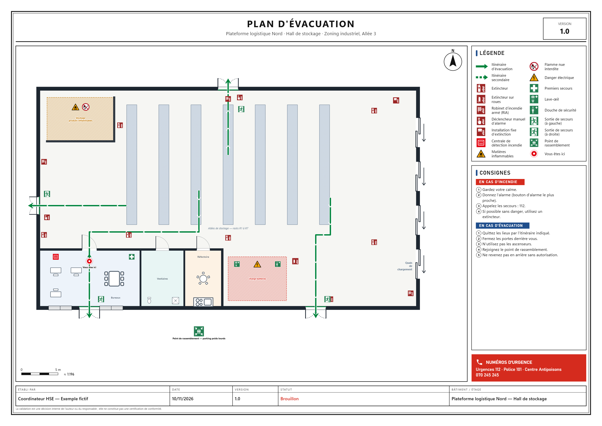
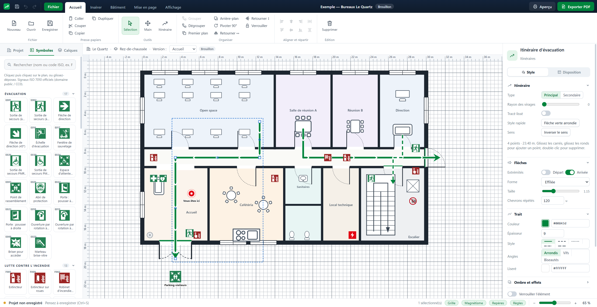

# Atelier Plans d'Évacuation

Logiciel de bureau Windows, en français et **entièrement hors ligne**, pour créer des plans d'évacuation : import d'un plan existant (PDF/image), dessin du bâtiment, pictogrammes, itinéraires, cartouche, consignes, exports PDF/PNG et impression A4/A3.

- Installateur : `Atelier-Plans-Evacuation-Setup-2.0.0.exe`, à la racine du dossier « Atelier Plans Evacuation » et dans les publications GitHub (raccourcis Bureau + menu Démarrer, association des fichiers `.planevac`, désinstallation depuis les Paramètres Windows).
- Guide d'utilisation : [docs/GUIDE.md](docs/GUIDE.md)
- Format des fichiers projet : [docs/FORMAT.md](docs/FORMAT.md)
- Vérifications effectuées : [docs/VERIFICATIONS.md](docs/VERIFICATIONS.md)
- Licences (code, pictogrammes, dépendances) : [LICENSES.md](LICENSES.md)

## Aperçu

| Bureaux — thème Moderne | École — thème Signalétique |
|---|---|
|  |  |
| **Hôtel — thème Épuré** | **Entrepôt — thème Institutionnel (A3)** |
|  |  |



## Nouveautés de la version 2

- **42 signaux ISO 7010 officiels** (domaine public / CC0, licence vérifiée, source de chaque fichier dans `src/symbols/iso7010/manifest.json`), récupérés par `scripts/fetch-iso7010.mjs`.
- **Ruban** à onglets (Accueil, Insérer, Bâtiment, Mise en page, Affichage) et panneau Propriétés détaillé (Style / Texte / Disposition : remplissage et motifs, traits et tirets, flèches, ombre, opacité, typographie).
- **4 thèmes de mise en page** (Moderne, Épuré, Institutionnel, Signalétique), couleur d’accent, A2, numéros d’urgence, flèche du nord.
- **4 plans d’exemple** présentés sur l’écran d’accueil.
- **Flèches d’évacuation** vertes prêtes à poser (demi-tour, virages, chicane, double sens) et rayon de virage sur tous les itinéraires.
- Nouveaux éléments : fenêtres, formes, 5 types de portes, 3 types d’escaliers, mobilier ; surfaces des pièces.
- Grille plus contrastée et réglable (lignes / points, pas, maillage, intensité), règles graduées en mètres.
- Format de fichier v2 ; les projets v1 sont migrés automatiquement à l’ouverture.
- **Mises à jour proposées au démarrage** depuis le dossier « Atelier Plans Evacuation » (ou un dossier réseau) et, si Internet est disponible, depuis les publications GitHub.
- Dépôt : https://github.com/ARBJ-prevention/atelier-plans-evacuation

## Architecture

| Couche | Technologie | Rôle |
|---|---|---|
| Application de bureau | **Electron 45** (`electron/`) | Fenêtre native, menus français, dialogues Windows, lecture/écriture des fichiers, sauvegarde automatique, export PDF (`printToPDF`) et impression (`webContents.print`). |
| Interface | **React 19 + TypeScript** (`src/`) | Éditeur, panneaux, aperçu avant impression. |
| Dessin | **SVG vectoriel** | Le même composant (`src/render/FloorDrawing.tsx`) dessine le plan dans l'éditeur et dans les exports : rendu net à tout zoom, PDF vectoriel (texte sélectionnable). |
| État | **zustand + immer** (`src/store/store.ts`) | Projet immuable, historique annuler/rétablir (150 étapes), presse-papiers, sélection. |
| Import PDF | **pdf.js** (embarqué) | Rastérisation haute définition (~4000 px) de la page choisie comme plan de fond. |
| Installateur | **electron-builder / NSIS** | Installation par utilisateur, sans droits administrateur. |

Sécurité : isolation de contexte, bac à sable du rendu, aucune navigation externe, aucun accès réseau. Les fichiers de l'interface sont servis par un protocole interne `app://`.

```
electron/        processus principal (main.cjs), pont sécurisé (preload.cjs), menus (menu.cjs)
src/model/       types du projet, valeurs par défaut, géométrie, lecture/écriture du format, profils pays
src/symbols/     bibliothèque : signaux ISO 7010 (iso7010/*.svg + manifest.json) et compléments CC0
src/render/      rendu SVG des éléments, mise en page d'impression (layout.ts, PrintPage.tsx)
src/editor/      zone de dessin interactive (outils, sélection, poignées, repères, zoom)
src/panels/      ruban, projet, bibliothèque, calques, propriétés
src/dialogs/     aperçu avant impression / export
src/app/         actions, plans d'exemple, flèches d'évacuation prédéfinies
src/services/    pont Electron typé, imports PDF/images, génération HTML/PNG des exports
src/selftest.ts  autotest de bout en bout exécuté dans l'application réelle
tests/           tests unitaires (vitest)
scripts/         récupération des pictogrammes ISO 7010 (étape de développement uniquement)
```

## Développement

Prérequis : Node.js 20+ (testé avec Node 24).

```bash
npm install
```

```bash
npm run app
```
(compile l'interface puis lance l'application)

```bash
npm test
```
(tests unitaires)

```bash
npm run selftest
```
(autotest complet dans l'application ; rapport et fichiers produits dans `%TEMP%\atelier-evac-selftest`)

```bash
npm run dist
```
(génère l'installateur dans `release/`)

> Remarque : NSIS ne supporte pas les chemins de plus de 260 caractères. Si le dossier du projet est très profond, copiez-le dans un dossier court (ex. `C:\dev\atelier-evac`) avant `npm run dist`.

## Publier une mise à jour

1. Modifier le numéro de version dans `package.json` et décrire les nouveautés dans `CHANGELOG.md`.
2. Construire et publier :

```bash
npm run release
```
(construit l'installateur, le copie à la racine du dossier « Atelier Plans Evacuation », retire l'ancien et écrit `mise-a-jour.json`)

```bash
npm run release:github
```
(fait la même chose et crée en plus la publication GitHub `vX.Y.Z` avec l'installateur)

Au démarrage suivant, chaque poste installé propose la mise à jour (dossier local ou partagé, ou GitHub si Internet est disponible).

## Choix et hypothèses

- **Electron plutôt que WPF/.NET** : un seul moteur de rendu vectoriel (SVG) pour l'écran, le PDF et l'impression garantit que ce qui est affiché est exactement ce qui est exporté ; l'outillage est disponible sans SDK supplémentaire. Contrepartie : installateur d'environ 116 Mo.
- **Unités** : les coordonnées sont en « unités plan » ; l'outil *Étalonner* fixe la correspondance avec le mètre (par étage). L'échelle d'impression fixe (1:N) nécessite cet étalonnage.
- **Plans PDF importés** : rastérisés à l'import (le fond n'est pas éditable, ce qui est le cas d'usage habituel d'un calque de travail). Les éléments dessinés restent vectoriels.
- **Versions « Vous êtes ici »** : chaque étage possède une ou plusieurs versions ; tout élément peut être commun ou propre à une version.
- **Validation** : jamais automatique. Le statut « Validé » est posé par une action explicite (nom + case de confirmation) et repasse à « À valider » à la moindre modification du plan.
- **Pays** : Belgique par défaut (profils FR, CH, LU et générique ISO disponibles) — ils fournissent les consignes types et un rappel des référentiels à vérifier, sans prétendre à une conformité.
- **Non signé** : l'installateur n'est pas signé numériquement ; Windows SmartScreen peut afficher un avertissement au premier lancement (« Informations complémentaires » › « Exécuter quand même »).
