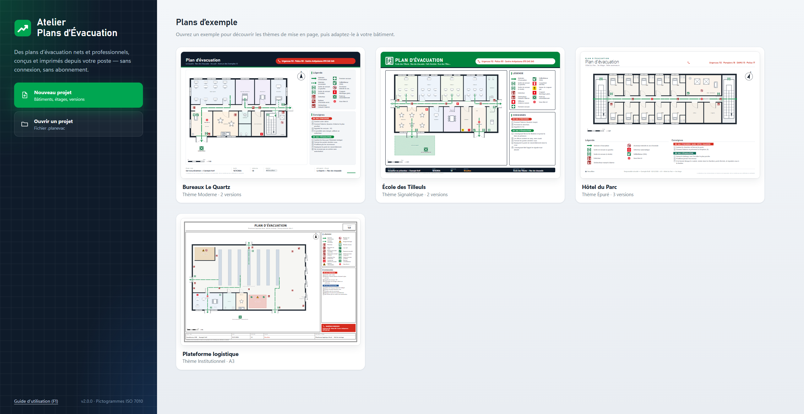
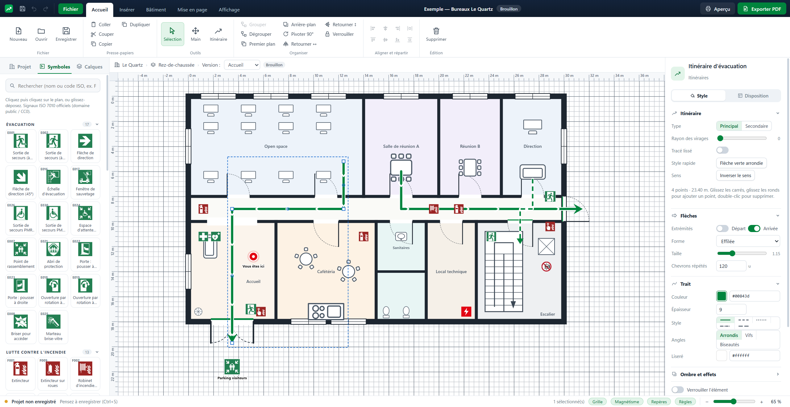

# Guide d'utilisation — Atelier Plans d'Évacuation

## Essayer les nouveautés de la 2.0.11

1. Sur l’accueil, cliquez sur **Essayer les nouveautés**. Dans l’aperçu, passez d’**Accueil** à **Couloir est** pour voir le repère « Vous êtes ici » changer d’emplacement.
2. Au-dessus du plan, créez un **Emplacement d’affichage** et choisissez **Créer des copies modifiables pour cette affiche**. Placez le repère, puis sélectionnez un itinéraire. Sa portée s’affiche sous son nom dans **Propriétés**.
3. Ouvrez **Aperçu → Exporter le bâtiment**. Sélectionnez les affiches des deux étages, prévisualisez-les et choisissez un PDF regroupé ou un fichier par affiche.

Dans **Symboles**, l’étoile ajoute un pictogramme aux favoris. **Mise en page → Modèles** permet d’enregistrer les réglages de l’étage sur ce poste et de les appliquer à d’autres étages. La modification des consignes ou des numéros d’urgence remet un étage validé **À valider**.

## 1. Installation

1. Lancez `Atelier-Plans-Evacuation-Setup-2.0.0.exe`.
2. Choisissez le dossier d'installation (aucun droit administrateur requis).
3. Un raccourci est créé sur le Bureau et dans le menu Démarrer. Les fichiers `.planevac` s'ouvrent par double-clic.

Le logiciel fonctionne sans connexion Internet, sans compte et sans abonnement. Windows SmartScreen peut afficher un avertissement au premier lancement (installateur non signé) : « Informations complémentaires » › « Exécuter quand même ».

## 2. L'écran d'accueil et les plans d'exemple

L'accueil propose **Nouveau projet**, **Ouvrir un projet**, les projets récents et quatre **plans d'exemple** à ouvrir d'un clic :

| Exemple | Thème | Particularités |
|---|---|---|
| Bureaux Le Quartz | Moderne | 2 versions « Vous êtes ici », mobilier, nord |
| École des Tilleuls | Signalétique | cour de récréation, consignes adaptées |
| Hôtel du Parc | Épuré | 3 versions, deux escaliers de secours |
| Plateforme logistique | Institutionnel, A3 | zones de danger hachurées, racks, quais |

Ouvrez un exemple puis enregistrez-le sous un autre nom pour vous en servir de modèle.

## 3. L'interface

- **Ruban** (en haut), comme dans les logiciels de dessin bureautiques :
  - *Accueil* : fichier, presse-papiers, outils, organiser (grouper, ordre, pivoter, retourner, verrouiller), aligner et répartir ;
  - *Insérer* : plan de fond, itinéraires, **flèches d'évacuation**, pictogrammes, textes, légende, images, formes ;
  - *Bâtiment* : murs et cloisons, fenêtres, 5 types de portes, 3 types d'escaliers, pièces, zones, étalonnage ;
  - *Mise en page* : thème, couleur d'accent, papier, orientation, position de la légende, éléments de la page ;
  - *Affichage* : zoom, grille (lignes ou points, pas, maillage, intensité), règles, repères.
- **Panneau gauche** : *Projet* (bâtiments, étages, versions), *Symboles* (bibliothèque), *Calques*.
- **Zone de dessin** avec règles graduées en mètres une fois l'échelle étalonnée.
- **Panneau Propriétés** (droite), en trois onglets pour l'élément sélectionné :
  - *Style* : propriétés du type d'élément, remplissage (couleur, opacité, motifs), trait (couleur, épaisseur, 5 styles de tirets, angles), flèches, ombre portée, opacité ;
  - *Texte* : contenu, police, taille, gras / italique / souligné / majuscules, alignement, interligne, espacement, cadre ;
  - *Disposition* : position, taille, rotation, calque, versions.
  
  Sans sélection, il affiche *Plan* (statut, cartouche, numéros d'urgence, consignes), *Page* (thème et format) et *Fond* (plan importé, échelle).
- **Barre d'état** : enregistrement, grille, magnétisme, repères, règles, curseur de zoom.

## 4. Importer un plan existant

1. **Insérer › Plan DXF / PDF** : DXF (AutoCAD), PDF, PNG, JPEG… (numéro de page demandé pour un PDF multipage).
   - **DXF** : le plan est importé en **vectoriel**, net à tous les zooms, **à l'échelle réelle** : l'unité du dessin (mm, cm, m…) est lue dans le fichier, l'étage est étalonné automatiquement, aucun étalonnage n'est nécessaire. Une fenêtre permet de choisir les calques à garder (décochez cotes, mobilier, points topographiques, cartouche…) avec un aperçu et les dimensions réelles. Si le fichier n'indique pas d'unité, choisissez-la en vérifiant les dimensions affichées.
   - **DWG** : lu grâce à **ODA File Converter**, outil gratuit de l'Open Design Alliance à installer une fois sur le poste (le logiciel le trouve tout seul dans *Program Files\ODA*). S'il manque, une fenêtre guide l'installation : bouton vers la page de téléchargement, puis « C'est installé », ou « Indiquer son emplacement… » s'il est installé ailleurs. Le DWG est converti en DXF dans un dossier temporaire (supprimé ensuite), puis importé comme un DXF. Sans ODA, il reste possible de faire *Enregistrer sous › DXF* dans AutoCAD.
   - **Redessiner le plan** (DXF et DWG, case cochée par défaut) : le logiciel reconnaît les **murs** (doubles traits, raccordés aux angles ; cloisons en simple trait), les **portes** (battants en arc, portes doubles comprises), les **fenêtres** (recalées dans l'épaisseur du mur), les **escaliers** (marches régulièrement espacées) et les **pièces** avec leur **nom** (contours fermés d'un calque « pièces », sinon zone délimitée par les murs autour de chaque nom ; surface affichée si le plan l'indiquait). Une fenêtre de vérification montre le plan redessiné par-dessus le plan importé, avec le nombre d'éléments trouvés. Chaque calque y reçoit un rôle deviné d'après son nom (Murs, Cloisons, Portes, Fenêtres, Escaliers, Contours de pièces, Noms des pièces, Autre, Ignorer) : changez-le si un élément manque ou est en trop, l'aperçu se met à jour. Décochez les catégories inutiles, puis **Ajouter au plan** (une seule étape d'annulation) ou **Garder le fond seul**. Le plan importé reste en fond, atténué : masquez le calque *Fond* pour voir le plan redessiné seul. Il ne reste qu'à ajouter les pictogrammes et les itinéraires. Vérifiez toujours le résultat : la reconnaissance dépend de la façon dont le plan a été dessiné.
2. Onglet *Fond* des propriétés : opacité, **niveaux de gris**, largeur, verrouillage (déverrouillez pour déplacer le fond à la souris).
3. **Étalonner** (`K`, inutile pour un DXF) : cliquez deux points d'une cote connue, saisissez la distance réelle. Les règles, les longueurs, les surfaces et l'impression à l'échelle 1:N deviennent disponibles.

## 5. Dessiner le bâtiment

| Outil | Touche | Utilisation |
|---|---|---|
| Mur / cloison | `M` | Clics successifs ; double-clic ou `Entrée` pour terminer. `Maj` = angles à 45°. Rendu plein, hachuré ou contour. |
| Porte | `P` | Battante, double, coulissante, tambour, baie libre ; options « issue de secours » (seuil vert) et « porte coupe-feu » (seuil rouge, libellé « CF » ou « EI 30 »…, entrée de légende automatique). |
| Fenêtre | `F` | Un clic sur le mur ; largeur, épaisseur et nombre de vantaux réglables. |
| Escalier | `E` | Tracez un rectangle ; droit, avec palier ou escalator. |
| Pièce / zone | `R` / `Z` | Cliquez les angles ; nom, surface automatique, couleur, motif (hachures pour les zones de danger). |
| Forme | `S` | Rectangle, ellipse, triangle, losange, hexagone, ligne, flèche pleine, étoile. |
| Texte | `T` | Clic pour placer, puis saisie dans l'onglet *Texte*. |

## 6. Pictogrammes

Onglet **Symboles** : **97 signaux ISO 7010 officiels** (codes E, F, P, W, M affichés) et plus de 90 pictogrammes dessinés pour le logiciel, classés en 12 catégories. Les trois premières sont ouvertes au démarrage ; cliquez sur un titre pour ouvrir ou fermer une catégorie, ou utilisez **Tout déplier / Tout replier**.

- *Évacuation* : sorties de secours (gauche, droite, PMR, escalier, échelle), flèches, point de rassemblement, espace d'attente sécurisé, ouverture des portes, brise-vitre, BAES, éclairage d'ambiance, escaliers d'évacuation, guide-file ;
- *Lutte contre l'incendie* : extincteurs (dont eau, CO₂, poudre, mousse), RIA, déclencheur manuel, colonnes sèche et humide, poteau d'incendie, sprinkleurs, détecteurs, diffuseurs sonore et lumineux, centrale incendie, désenfumage, exutoire, clapet coupe-feu, couverture anti-feu ;
- *Premiers secours* : premiers secours, DEA, téléphone d'urgence, lave-œil, douche de sécurité, civière, trousse, infirmerie, SST ;
- *Interdictions*, *Dangers*, *Obligations* : signaux ISO 7010 P, W et M (EPI, risques, accès) ;
- *Repères* : « Vous êtes ici », nord, accès des secours, boîte à clés, local à risques ;
- *Coupures et commandes* : électricité, TGBT, gaz, eau, fioul, photovoltaïque, ventilation, chauffage, arrêt d'urgence ;
- *Structure du bâtiment*, *Mobilier*, *Sanitaires et cuisine*, *Équipements techniques* : portes, fenêtres, escaliers, rampe, ascenseur, bureaux, tables, rayonnages, WC (dont PMR), cuisine, chaudière, baie informatique… (exclus automatiquement de la légende).

Recherchez par nom, par code (ex. « F001 ») ou par catégorie, cliquez puis cliquez sur le plan, ou glissez-déposez. Propriétés : taille, pastille blanche, libellé (position, taille, couleur). **Importer un pictogramme** permet d'ajouter vos propres fichiers SVG ou PNG.

## 7. Itinéraires et flèches d'évacuation

**Itinéraire** (`I`) : cliquez les points de passage, double-clic pour terminer. Puis :
- glissez un **carré** pour déplacer un point ; glissez un **rond** pour en ajouter un ; **double-cliquez** un carré pour le supprimer ;
- *Style* : principal / secondaire, **rayon des virages**, tracé lissé, sens, forme des flèches (triangle, effilée, ouverte, double chevron, rond, carré), taille, **chevrons répétés** le long du tracé, couleur, épaisseur, style de tirets, angles, **liseré** blanc pour la lisibilité.

**Flèches d'évacuation prêtes à poser** (*Insérer › Flèches d'évacuation*) : demi-tour (à droite ou à gauche), tout droit, virage à droite, virage à gauche, chicane, double sens. Vertes, trait épais à bouts arrondis, virages en arc de cercle et pointe ouverte. Un clic les insère au centre de la vue ; ce sont des itinéraires ordinaires : déplacez-les, faites-les pivoter, modifiez leurs points de passage, leur épaisseur ou le rayon des virages. Le bouton **Style rapide › Flèche verte arrondie** applique ce rendu à n'importe quel itinéraire.

## 8. Plusieurs plans « Vous êtes ici » pour un même étage

Onglet **Projet › Versions de ce plan** : une version par emplacement d'affichage. Les éléments sont communs sauf ceux marqués « Uniquement cette version » (*Disposition › Versions*). Le pictogramme « Vous êtes ici » est automatiquement propre à la version active. À l'export : « Cette version » ou « Toutes » (une page par version).

## 9. Modifier et organiser

- Sélection : clic, `Maj`+clic, rectangle (gauche → droite : éléments inclus ; droite → gauche : éléments touchés).
- Déplacement à la souris ou aux flèches (`Maj` ×5) ; **repères d'alignement** roses ; `Alt` désactive le magnétisme.
- Poignées : coins = redimensionner (`Maj` = proportionnel pour les formes), rond vert = pivoter (5°, `Maj` = 45°).
- Aligner, répartir, grouper (`Ctrl+G`), retourner, premier / arrière-plan, verrouiller.
- `Ctrl+C / X / V / D`, `Suppr`, `Ctrl+Z / Ctrl+Y` (150 étapes).
- **Calques** : plan de fond, bâtiment, itinéraires, pictogrammes, textes — masquables, verrouillables ; cliquez un nom de calque pour en sélectionner tout le contenu.

## 10. Mise en page et thèmes

*Mise en page* (ruban) ou onglet *Page* :
- **Thèmes** :
  - *Moderne* : bandeau sombre, cartes arrondies ;
  - *Épuré* : blanc, filets fins ;
  - *Institutionnel* : cadre double, cartouche en tableau ;
  - *Signalétique* : bandeau vert haute visibilité.
- **Couleur d'accent**, couleur de fond du plan.
- Papier **A4, A3, A2**, portrait ou paysage, marges ; légende à droite, à gauche ou en bas.
- Éléments : en-tête et cartouche, légende automatique (pictogrammes et types d'itinéraires utilisés), consignes, **numéros d'urgence**, barre d'échelle, flèche du nord, filigrane.

Dans les consignes, une ligne en MAJUSCULES devient un titre coloré (rouge pour l'incendie, couleur d'accent pour l'évacuation) et « 1. … » une étape numérotée.

## 11. Cartouche et statut

Onglet *Plan* : titre, sous-titre, auteur, organisation, date, version, logo.

**Statut** : *Brouillon* → *À valider* → *Validé*.
- La validation est une action explicite (**Valider…**, nom et case de confirmation).
- Toute modification d'un plan validé le repasse à « À valider ».
- Le logiciel ne certifie jamais la conformité.

## 12. Aperçu, impression et exports

**Aperçu** (`Ctrl+P`) :
- thème, papier, orientation, marges ;
- échelle ajustée ou fixe 1:N ;
- zone imprimée (tout le plan, ou zone personnalisée / vue actuelle) ;
- contenu de la page.

Sorties :
- **Imprimer…** : dialogue d'impression Windows ;
- **Exporter en PDF** : vectoriel, textes et pictogrammes nets ;
- **Exporter en PNG** : 150, 300 ou 600 ppp.

## 13. Sauvegarde automatique et récupération

Un fichier de secours est écrit toutes les 30 secondes si le projet a changé ; après une fermeture inattendue, le logiciel propose de le restaurer. Chaque enregistrement conserve la version précédente en `.bak`.

## 14. Raccourcis

`F1` guide · `V` sélection · `H` vue · `M` mur · `P` porte · `F` fenêtre · `E` escalier · `R` pièce · `Z` zone · `S` forme · `I` itinéraire · `T` texte · `L` légende · `K` étalonner · molette = zoom · `Espace`+glisser ou clic milieu = déplacer la vue · `Ctrl+0` ajuster.

## 15. Mises à jour

À chaque démarrage, le logiciel recherche une version plus récente :
1. dans le dossier **Mes documents › Atelier Plans Evacuation** (fichier `mise-a-jour.json` et installateur `Atelier-Plans-Evacuation-Setup-X.Y.Z.exe`) ;
2. sur **GitHub** (publications du dépôt), seulement si Internet est disponible.

Si une version plus récente existe, il propose **Installer maintenant**, **Plus tard** ou **Ignorer cette version**. L'installation ferme le logiciel et lance l'installateur ; vos projets ne sont pas touchés. L'empreinte SHA-256 de l'installateur local est vérifiée avant de le lancer.

Menu **Aide** :
- *Rechercher des mises à jour…* : vérification immédiate ;
- *Réglages des mises à jour…* : choisir un autre dossier (par exemple un dossier partagé sur le réseau de votre organisation), activer ou désactiver la recherche sur GitHub.
